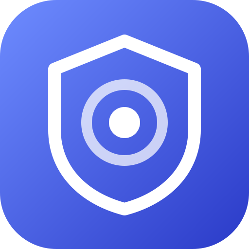

<p align="center">
  
</p>

<div align="center">

# dsh-tailnet-admin

[](https://github.com/deepseek-ai/deepseek-harness)

</div>

Sign in to DSH with your Tailscale account, no token needed.

> ⚠️ This plugin touches an authentication boundary: **it does nothing by default**, so installing it never
> widens access. Read [Security boundary](#security-boundary-read-this) before filling in `allowedUsers`.

## What it does

When you open DSH from the tailnet, `tailscale serve` adds `Tailscale-User-Login` to the request. The plugin
hands that login name to the host's connection authentication: listed users get in directly, everyone else logs
in as usual.

After login, the settings page, model directory, and plugin config all work.

## Install

Requires Node `^22.19.0 || >=24.0.0` and DSH `0.2.3-alpha.2` or newer.

```sh
npx @deepseek-ai/dsh plugin --profile web add @he0119/dsh-tailnet-admin
```

Add the package to `dsh.profile.bundles`, or enable it under **Settings → Plugins**, then restart DSH:

```json
// ~/.dsh/profiles/web/package.json
"dsh": { "profile": { "bundles": ["@he0119/dsh-tailnet-admin"] } }
```

Behind a reverse proxy or tailnet address, pass `--trusted-host <your domain>` to `dsh web`, or requests stop
at the Host/Origin fence.

## Settings

**Settings → Plugins → dsh-tailnet-admin**: enter Tailscale login names, one per line; Save applies immediately.

```yaml
# same as filling the form; editing the profile works too
- id: tailnet-admin
  name: '@he0119/dsh-tailnet-admin'
  config:
    allowedUsers:
      - alice@example.com
```

| Setting | Default | Effect |
| --- | --- | --- |
| `allowedUsers` | `[]` | Tailscale logins that skip the token. Empty = leave authentication alone |

The login name is your account in the Tailscale admin console (usually an email), not a device or display name.
When the plugin refuses someone it logs the real login name; copy that line.

## Security boundary (read this)

- **A listed user** who opens the page gains control of the machine: read and write files, run commands, use your
  API keys. Keep the list short.
- **Anyone else** is not admitted automatically, but the plugin cannot veto: a caller with a valid login cookie of
  their own may still get in.
- **DSH must listen on `127.0.0.1` only**: the check rests on the header being added by tailscale serve; exposing
  the port directly lets anyone forge it.
- Requests without the header (Funnel, tagged devices, direct connections) still have to log in.

## Troubleshooting

| Symptom | Cause |
| --- | --- |
| Requests return 403 | `dsh web` is missing `--trusted-host`; the Host/Origin fence rejected them |
| Still asked to log in | `allowedUsers` is empty, the login name is not listed, or the request did not come through tailscale serve |
| A listed user is refused too | Wrong login name; the log line "没有自动放行…" shows the real one |
| The config page cannot read the section | The `id` of that `cordis.patch.yml` row is not `tailnet-admin` |

## Development

Building, testing, and local verification: [docs/development.md](docs/development.md). Implementation details:
[docs/internals.md](docs/internals.md). Releases: [docs/releasing.md](docs/releasing.md).
