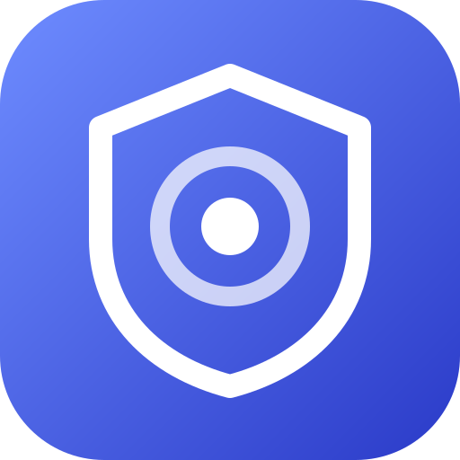

<p align="center">
  
</p>

<div align="center">

# dsh-tailnet-admin

[](https://github.com/deepseek-ai/deepseek-harness)

</div>

Treat Tailnet / reverse-proxy pages as local: make DSH's settings pages work from a non-loopback origin, and
let only named Tailscale users in without a token (the Host/Origin fence stays).

> ⚠️ This plugin touches an authentication boundary: **the authentication setting does nothing by default**, so
> installing it never widens access; `pageHosts` defaults to `.ts.net` and only affects browser-side settings
> persistence. Read [Security boundary](#security-boundary-read-this) before filling in `allowedUsers`.

## What it fixes

Opening DSH from `https://dsh.example.ts.net` (any Tailnet service name or reverse-proxy hostname) runs into two
independent problems:

**① Settings pages are unusable**: the model/provider directory, credentials and the config-file editor report
`settings are unavailable in this browser`. DSH's browser half only treats two cases as "local" — the
`globalThis.__DSH_TRANSPORT__ = { ownsHost: true }` flag injected by the desktop shell, or a page whose
`location.hostname` is loopback (`localhost` / `127.0.0.0/8` / `[::1]`). A page served from a domain satisfies
neither, so settings fall back to process-local persistence and report themselves unavailable. **That decision
lives in the browser half; the server-side `--trusted-host` cannot influence it.**

**② Every restart asks for a token again**: the host judges `/api` with two layers — a Host/Origin fence plus a
browser-session check. The latter wants a cookie minted from `?token=`, bound to the request authority; the token
is regenerated on each start, and the cookie stops matching as soon as the authority changes.

When traffic comes in through Tailscale, `tailscale serve` adds `Tailscale-User-Login` (the requester's login
name, for example `alice@example.com`) to the request it forwards to DSH, and removes any incoming header of that
name first so clients cannot forge it. The plugin can trust that header alone: listed users no longer need a
token, requests carrying it from anyone else are refused, and requests without it (no tailscale serve, Funnel,
tagged devices) fall back to the original cookie check.

The plugin splits those into two independent settings: `pageHosts` for ① (defaults to `.ts.net`) and
`allowedUsers` for ② (defaults to empty). Rationale and cost live in
[.agents/notes/implemented/](.agents/notes/implemented) (Chinese).

## Install

Requires Node `^22.19.0 || >=24.0.0` (same range as official DSH).

### 1. Add the package

```sh
npx @deepseek-ai/dsh plugin --profile web add @he0119/dsh-tailnet-admin
```

The published tarball ships a compiled `lib/`, so no build script has to be approved. For local development,
install the repository directory instead (after `pnpm run build`):

```sh
npx @deepseek-ai/dsh plugin --profile web add link:/path/to/dsh-tailnet-admin
```

### 2. Register it as a bundle

`dsh plugin add` only runs `pnpm add`. At startup DSH reads **only** `dsh.profile.bundles`, so add the package name
there:

```json
// ~/.dsh/profiles/web/package.json
"dsh": {
  "profile": {
    "bundles": [
      // …
      "@he0119/dsh-tailnet-admin"
    ]
  }
}
```

The GUI does the same thing: **Settings → Plugins** lists packages that are installed but not enabled yet, and
enabling one edits exactly that array.

Restart DSH afterwards (`systemctl --user restart dsh-web` for a systemd deployment). The startup log will show
the `[dsh-tailnet-admin] …` lines when it is in place.

### 3. Fill in the settings (the config page)

**Settings → Plugins → `dsh-tailnet-admin`**: the form sits right below the description on this plugin's own
bundle page.

- **Domains where settings work**: one per line; the default is `.ts.net` (the Tailnet MagicDNS suffix).
  A leading `.` means suffix match (`.ts.net` matches `a.ts.net`, not the bare `ts.net`); an exact hostname and
  `*` work too. Put a custom domain or reverse-proxy host here. Saving an empty box means no injection;
  **Reset** returns to `.ts.net`.
- **Tailscale users without a token**: one per line, the full Tailscale login name (for example
  `alice@example.com`), case-insensitive. An empty box leaves the browser session check alone. Read
  "Security boundary" before filling it in.

Press **Save**. `allowedUsers` takes effect immediately, `pageHosts` applies to the **next page load**
(refresh once); neither needs a DSH restart.

The login name is your user account in the Tailscale admin console (usually an email), not a device or display
name. When the plugin refuses someone it writes the real login name to the log
(`[dsh-tailnet-admin] 拒绝了不在 allowedUsers 里的 Tailscale 用户：…`); copy that line.

> The default `.ts.net` already covers common Tailnet domains, so a page opened from `*.ts.net` can save these
> settings on the first visit — no loopback detour. Only when the page host is not under `.ts.net` (a custom
> domain or reverse proxy) do you need to open DSH **over a loopback address** (`http://localhost:3080`) once,
> or write the profile's `cordis.patch.yml` directly:

```yaml
# ~/.dsh/profiles/web/cordis.patch.yml
- id: tailnet-admin            # this id is a fixed contract of the plugin: the config page reads this section by it, do not rename
  name: '@he0119/dsh-tailnet-admin'
  config:
    pageHosts:
      - dsh.example.com      # omit this setting for the default .ts.net; custom domains/reverse proxies only
    allowedUsers:
      - alice@example.com    # your Tailscale login name; empty = leave authentication alone
```

## Settings

| Setting | Default | Effect |
| --- | --- | --- |
| `pageHosts` | `['.ts.net']` | Which page hosts count as local. A leading `.` means suffix match; `*` matches everything; an explicit empty array injects nothing |
| `allowedUsers` | `[]` | Which Tailscale login names skip the browser session check. Empty = leave authentication alone |

Both places edit the same config: **the plugin config page** (`Settings → Plugins → dsh-tailnet-admin`) saves
into exactly the `config` block of that profile `cordis.patch.yml` row. Editing the file by hand and editing the
page are equivalent — there is no precedence.

- Both fields take one entry per line; the page also accepts commas, so a line copied from this document needs no
  editing.
- Omitting `pageHosts` uses the default `.ts.net`; saving an empty box writes an **explicit empty array** (inject
  nothing), not "fall back to the default".
- Entries that can never match are **blocked at save time** on the page: hosts only understand `*`, a
  dot-prefixed suffix, and an exact hostname; login names are matched case-insensitively as a whole printable
  ASCII string (no wildcards, commas, display names, spaces, or non-ASCII). Anything else would sit there silently
  doing nothing, so it is better to stop the save.
- An `allowedUsers` value that is not an array of strings (a single string, for example) makes the Loader
  **refuse the entry** instead of guessing what it meant.

A systemd deployment only owns the fence layer; the two settings are not environment variables (see the decision
record under [.agents/notes/implemented/](.agents/notes/implemented), in Chinese):

```ini
[Service]
ExecStart=%h/.npm/_npx/<hash>/node_modules/.bin/dsh web --host 127.0.0.1 --port 3080 \
  --trusted-host dsh.example.ts.net --public-url https://dsh.example.ts.net/ --no-open
```

> `--trusted-host` (or the connection plugin's `trustedHosts`) is a **separate** requirement: the `/api`
> Host/Origin fence only accepts loopback or a declared authority. Filling in this plugin's `allowedUsers`
> without it still ends in a 403 at the fence.
>
> `--public-url` (DSH `0.2.1-alpha.1` and later) is advertisement only: it changes the address DSH reports —
> the printed and opened startup URL, `DSH_WEB_URL`, and the orientation handed to the model — and configures no
> listener, routing, or cookie scope. It **grants no trust**, so it replaces none of this plugin's settings. What
> it buys you is that the `?token=` exchange mints its cookie for the authority your browser actually uses,
> instead of you transplanting the token by hand.

## Security boundary (read this)

`allowedUsers` changes "who may enter this UI without a token". Once the list is non-empty:

- **A listed user** who opens the page gains control of the machine — read and write files, run commands, use the
  API keys you configured in DSH. Keep the list short: only people who really need remote admin on this machine.
- **Anyone else on the tailnet**: a request carrying `Tailscale-User-Login` is refused, even if the caller still
  holds a cookie from earlier. Requests without that header (no tailscale serve, Funnel, tagged devices) fall
  back to the original token check; the plugin never treats a header-less request as authenticated.
- **DSH must listen on loopback only.** The whole decision rests on "`Tailscale-User-Login` was added by
  tailscale serve". [Tailscale's own docs require the backend to listen on localhost](https://tailscale.com/docs/features/tailscale-serve#identity-headers); otherwise anyone who can
  reach the port directly can write that header themselves. `dsh web` listens on `127.0.0.1` by default — do not
  change `--host` to `0.0.0.0` or a Tailnet IP. The Host/Origin fence stops forged Host headers and cross-site
  requests; it does **not** stop someone who can connect to the port.
- **Tagged devices and Funnel carry no identity headers**: those requests fall back to the token check, so this
  list cannot help them.
- **Shared nodes**: after you share a device, the other person's requests carry **their own** login name; unless
  it is listed, they stay out.
- What remains is the **Host/Origin fence**: loopback or a declared authority, plus a rejection of
  `Sec-Fetch-Site: cross-site`. It stops DNS rebinding and cross-site requests; it does **not** stop someone who
  simply knows the address.
- `pageHosts`, by contrast, only affects **browser-side** settings persistence and UI availability. It changes no
  server-side decision. The `.ts.net` default follows from the plugin's scope, not from an authentication choice;
  clear the list on the config page if you want no injection at all.

Suggested posture: leave `pageHosts` at `.ts.net` and add a custom domain only when needed; put only your own
login name in `allowedUsers`, never "everyone on the tailnet". To revert authentication, clear the list on the
config page (or remove `allowedUsers` from `cordis.patch.yml`): the token check returns immediately. To stop
page injection as well, clear the page hosts and save (an explicit empty array); it applies on the next page
load. There is no state to clean up.

> Upgrading from the old version: `disableBrowserAuth: true` is no longer in the schema, so the Loader silently
> ignores it — the effect is the original authentication coming back. Replace it with an `allowedUsers` list, or
> the page will start asking for a token again. Also, an omitted `pageHosts` now defaults to `.ts.net` (it used to
> be empty); configs that already set a value, including `[]`, keep it.

## Troubleshooting

| Symptom | Cause |
| --- | --- |
| Still `settings are unavailable in this browser` | The current page host does not match `pageHosts` (the default only covers `.ts.net`; add custom domains/reverse proxies), or the page was not refreshed |
| Do not want injection on any page | Clear the page hosts on the config page and save (an explicit empty array); deleting the setting falls back to `.ts.net` |
| Requests fail with 403 | The Host/Origin fence rejected them: add `--trusted-host <authority>` to `dsh web` |
| Still asked for `?token=` | `allowedUsers` is empty; the current user's login name is not listed; or the request did not come through tailscale serve (tagged device, Funnel, direct connection), so there is no `Tailscale-User-Login` |
| A listed user is refused too | The login name is wrong (a display name or device name), or the request did not come through tailscale serve; the log line "拒绝了不在 allowedUsers 里的 Tailscale 用户：…" shows the real login name |
| No `[dsh-tailnet-admin]` line in the startup log | The name is missing from `dsh.profile.bundles`, or the package is not installed (check with `dsh --profile web --dump-config \| grep tailnet-admin`) |
| The config page says "this browser only" and the profile does not change | The current page is not treated as this machine: open DSH over loopback once, or edit `cordis.patch.yml` directly |
| The config page says the section cannot be read | The `id` of that `cordis.patch.yml` row is not `tailnet-admin`, or the row is not enabled |

## Development

[docs/development.md](docs/development.md) covers building, testing and the manual "install into a dedicated
profile and look at the page" path; [docs/internals.md](docs/internals.md) explains why the implementation looks
the way it does; [docs/releasing.md](docs/releasing.md) covers releases (including why the first version must be
published by hand).

```sh
pnpm install     # also runs prepare, i.e. a full build
pnpm test        # unit tests (offline)
pnpm run typecheck
pnpm run build
```

## License

[MIT](LICENSE)
