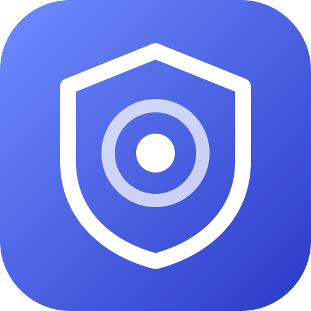

<p align="center">
  
</p>

<div align="center">

# dsh-tailnet-admin

[](https://github.com/deepseek-ai/deepseek-harness)

</div>

把 Tailnet / 反向代理页面当作「本机」来用：让 DSH 的设置页在非回环地址上可用，并按 Tailscale 身份
只放行指定用户（Host/Origin 栅栏保持不动）。

> ⚠️ 这个插件会动到认证边界：**认证那一项默认不做事**，装上去不会放宽任何访问；页面主机默认 `.ts.net`，
> 只影响浏览器端的设置持久化。填 `allowedUsers` 之前，请先读[安全边界](#安全边界必读)。

## 它解决什么

从 `https://dsh.example.ts.net`（任何 Tailnet 服务名或反向代理域名）打开 DSH 时会撞上两件独立的事：

**① 设置页用不了**：模型与提供商目录、凭据、配置文件编辑器报
`settings are unavailable in this browser`。原因是 DSH 的浏览器端只把两种情况当作「本机」——由桌面壳
注入的 `globalThis.__DSH_TRANSPORT__ = { ownsHost: true }`，或页面自身的 `location.hostname` 属于回环
（`localhost` / `127.0.0.0/8` / `[::1]`）。域名进来的页面两者都不满足，于是设置走「进程内」持久化并直接
报不可用。**这条判定在浏览器端，服务端的 `--trusted-host` 管不到它。**

**② 每次重启都要重新换 token**：宿主的 `/api` 判定是「Host/Origin 栅栏 + 浏览器会话认证」两层。认证那层
要一个由 `?token=` 换来的、**按 authority 绑定**的 cookie；token 每次启动都重新生成，cookie 换地址即失效。

从 Tailscale 进来时，`tailscale serve` 会在转发给 DSH 的请求上加 `Tailscale-User-Login`（请求者的登录名，
例如 `alice@example.com`），并且会先删掉入站请求里的同名头，避免客户端自己伪造。插件可以只认这个头：
名单里的用户不再需要 token；名单外但带着这个头的请求直接拒绝；没带这个头的访问（没经过 tailscale serve、
Funnel、tagged device）回落到原来的 cookie 校验。

插件把这两件事拆成两项独立配置：`pageHosts` 解决 ①（默认 `.ts.net`），`allowedUsers` 解决 ②（默认空表）。
为什么这么默认、代价是什么，见 [.agents/notes/implemented/](.agents/notes/implemented)（中文）。

## 安装

前提：Node `^22.19.0 || >=24.0.0`（与官方 DSH 一致）。

### 1. 装包

```sh
npx @deepseek-ai/dsh plugin --profile web add @he0119/dsh-tailnet-admin
```

发布产物里带着编译好的 `lib/`，安装时不需要授权任何构建脚本。本地改代码时直接装仓库目录（先
`pnpm run build`）：

```sh
npx @deepseek-ai/dsh plugin --profile web add link:/path/to/dsh-tailnet-admin
```

### 2. 注册为 bundle

`dsh plugin add` 只做 `pnpm add`。DSH 启动时**只读** profile 清单里的 `dsh.profile.bundles`，所以还要把
包名加进去：

```json
// ~/.dsh/profiles/web/package.json
"dsh": {
  "profile": {
    "bundles": [
      // …
      "@he0119/dsh-tailnet-admin"
    ]
  }
}
```

用图形界面也行：**设置 → 插件**里会列出「已安装但未启用」的包，启用一次做的是同一件事。

改完重启 DSH（systemd 部署的话：`systemctl --user restart dsh-web`）。启动日志里会出现
`[dsh-tailnet-admin] …` 那几行，说明插件到位了。

### 3. 填配置（配置页）

**设置 → 插件 → `dsh-tailnet-admin`**：本插件那张包页的描述下面就是配置表单，两项配置都在那儿。

- **设置页可用的域名**：一行一条，默认 `.ts.net`（Tailnet 的 MagicDNS 后缀）。`.` 开头 =
  后缀匹配（`.ts.net` 命中 `a.ts.net`，不命中裸 `ts.net`），也可以写精确主机名或 `*`；自定义域名/反代
  把这里改成你的域名。清空并保存 = 显式不注入（点「恢复默认」回到 `.ts.net`）。
- **不用 token 的 Tailscale 用户**：一行一条，写完整的 Tailscale 登录名（例如
  `alice@example.com`），不区分大小写。留空 = 不碰浏览器会话校验。填之前先读[安全边界](#安全边界必读)。

改完点**保存**。`allowedUsers` 立刻生效，`pageHosts` 在**下一次打开页面**时生效（刷新一次即可），
两者都不需要重启 DSH。

登录名就是 Tailscale 管理后台里你的用户账号（通常是邮箱），不是设备名或显示名。插件拒绝某个用户时会把
真实登录名打进日志（`[dsh-tailnet-admin] 拒绝了不在 allowedUsers 里的 Tailscale 用户：…`），照着那一行
填即可。

> 默认 `.ts.net` 已经覆盖了常见的 Tailnet 域名，所以从 `*.ts.net` 打开时配置页第一次就能正常保存，
> 不必再绕回环地址。只有当你访问的主机不匹配 `.ts.net`（自定义域名或反向代理）时，才需要先从回环地址
> 打开一次（`http://localhost:3080`），或者直接写 profile 的 `cordis.patch.yml`：

```yaml
# ~/.dsh/profiles/web/cordis.patch.yml
- id: tailnet-admin            # 这一行的 id 是本插件的固定约定：配置页按它取这一段设置，别改
  name: '@he0119/dsh-tailnet-admin'
  config:
    pageHosts:
      - dsh.example.com      # 不写这一项 = 默认 .ts.net；自定义域名/反代才需要加
    allowedUsers:
      - alice@example.com    # 你在 Tailscale 里的登录名；留空 = 不碰认证
```

## 配置

| 配置 | 默认 | 作用 |
| --- | --- | --- |
| `pageHosts` | `['.ts.net']` | 哪些页面主机按「本机」处理。`.` 开头 = 后缀匹配；`*` = 全部；显式空表 = 不注入 |
| `allowedUsers` | `[]` | 哪些 Tailscale 登录名可以免掉浏览器会话校验。空表 = 不碰认证 |

两处写的是同一份配置：**插件配置页**（`设置 → 插件 → dsh-tailnet-admin`）保存时落到的就是 profile 里
`cordis.patch.yml` 那一行的 `config`；手工写文件与在页面上改完全等价，没有优先级之分。

- 两个字段都是一行一条；配置页里也认逗号，从本文档抄一行过去不用改。
- `pageHosts` 不写这一项就用默认 `.ts.net`；清空输入框并保存写的是**显式空表**（不注入），不会回落到默认。
- 命不中的写法会在配置页里**当场挡住保存**：主机只认 `*`、`.` 开头的后缀、精确主机名；登录名只认转小写后
  整串相等的可打印 ASCII（没有通配符，逗号、显示名、空格、非 ASCII 都不行）。写进去只会静默不生效，所以不如
  在保存前挡住。
- `allowedUsers` 不是字符串数组（例如写成单个字符串）会被 Loader **拒绝加载**，而不是被猜成一项。

systemd 部署只负责栅栏那一层，两项配置不走环境变量（见
[.agents/notes/implemented/](.agents/notes/implemented) 里的那条决策）：

```ini
[Service]
ExecStart=%h/.npm/_npx/<hash>/node_modules/.bin/dsh web --host 127.0.0.1 --port 3080 \
  --trusted-host dsh.example.ts.net --public-url https://dsh.example.ts.net/ --no-open
```

> `--trusted-host`（或 profile 里 connection 插件的 `trustedHosts`）是**另一条**独立要求：`/api` 的
> Host/Origin 栅栏只认回环或声明过的 authority。只填本插件的 `allowedUsers`、不给 `--trusted-host`，请求会在
> 栅栏那一步就被 403 掉。
>
> `--public-url`（DSH `0.2.1-alpha.1` 起）是纯广告位：它只改 DSH 报出去的地址 —— 打印与打开的启动
> URL、`DSH_WEB_URL`、给模型的方位提示；不配置监听、路由或 cookie 作用域，**也不放宽信任**，所以替不掉
> 本插件的任何一项配置。它的用处是让 `?token=` 换 cookie 落在你真正使用的 authority 上，不必再手工把
> token 搬到对外地址。

## 安全边界（必读）

`allowedUsers` 改的是「谁可以免 token 进这个界面」。填了名单之后：

- **名单里的用户**打开页面就等于拿到这台机器的控制权 —— 读写文件、执行命令、动用你在 DSH 里配置的
  API key。所以名单要短，只写真正需要远程管理这台机器的人。
- **名单外的 Tailscale 用户**：请求只要带着 `Tailscale-User-Login`，一律拒绝，即使手里还留着以前换来的
  cookie 也一样。没带这个头的访问（没经过 tailscale serve、Funnel、tagged device）回落到原来的 token
  校验；也就是说这个插件不会把「没有身份头的请求」当成已认证。
- **必须只监听回环地址。** 这个判断完全建立在「`Tailscale-User-Login` 是 tailscale serve 加的」之上。
  [Tailscale 官方也要求后端只监听 localhost](https://tailscale.com/docs/features/tailscale-serve#identity-headers)；否则任何能直接打到这个端口的人都能自己写这个头。`dsh web`
  默认监听 `127.0.0.1`，不要改成 `0.0.0.0` 或 Tailnet IP。Host/Origin 栅栏挡的是伪造 Host 与跨站请求，
  **不挡**能直连端口的人。
- **Tagged device 与 Funnel 没有身份头**：请求会回落到 token 校验，这份名单帮不了它们。
- **共享节点**：把设备分享给别人后，对方访问时带的是**对方自己的**登录名；不在名单里就进不来。
- 保留下来的是 **Host/Origin 栅栏**：只认回环 Host 或 `--trusted-host` / `trustedHosts` 声明过的
  authority，并拒绝 `Sec-Fetch-Site: cross-site`。它挡的是 DNS 重绑定与跨站请求，**不挡**「知道地址的人」。
- 反过来，`pageHosts` 只影响**浏览器端**的设置持久化与界面可用性，它不改变服务端的任何判定。默认
  `.ts.net` 是插件场景决定的，不是认证开关；想彻底关掉注入，就在配置页把它清空并保存。

建议的组合：`pageHosts` 保持默认 `.ts.net`，自定义域名/反代再加一条；`allowedUsers` 只写自己的登录名，
别把「所有用 Tailscale 的人」都写进去。想撤回认证：在配置页把名单清空（或删掉 `cordis.patch.yml` 里的
`allowedUsers`）即可 —— 立刻恢复 token 校验。想连页面注入也停掉：把页面主机清空并保存（显式空表），
下一次打开页面时生效。没有任何状态需要清理。

> 从旧版升级：原来的 `disableBrowserAuth: true` 已经不在 schema 里，Loader 会静默忽略它，效果等于把认证
> 恢复原样。把它换成 `allowedUsers` 名单，否则页面会重新开始要 token。另外，`pageHosts` 现在不写时默认
> `.ts.net`（以前是空表）；已经显式写了值（包括 `[]`）的配置不变。

## 排障

| 现象 | 原因 |
| --- | --- |
| 设置页仍报 `settings are unavailable in this browser` | 当前页面主机不匹配 `pageHosts`（默认只含 `.ts.net`；自定义域名/反代要自己加），或改完还没刷新页面 |
| 不想在任何页面注入脚本 | 在配置页把页面主机清空并保存（显式空表），不是删掉这一项 |
| 请求直接 403 | Host/Origin 栅栏没过：给 `dsh web` 加 `--trusted-host <authority>` |
| 仍然要 `?token=` | `allowedUsers` 是空表；当前用户的登录名不在名单里；或者请求没经过 tailscale serve（tagged device、Funnel、直连），没有 `Tailscale-User-Login` |
| 名单里的用户也被拒 | 登录名写错（写成了显示名或设备名），或请求没经过 tailscale serve；看日志里「拒绝了不在 allowedUsers 里的 Tailscale 用户：…」那一行的真实登录名 |
| 启动日志里没有 `[dsh-tailnet-admin]` | 包名没写进 `dsh.profile.bundles`，或包没装上（`dsh --profile web --dump-config \| grep tailnet-admin` 可确认） |
| 配置页说「只写进这个浏览器」、保存后 profile 没变 | 当前页面没被当作「本机」：先从回环地址打开一次，或直接改 `cordis.patch.yml` |
| 配置页整段说「读不到这一节」 | `cordis.patch.yml` 里那一行的 `id` 不是 `tailnet-admin`，或者那一行没被启用 |

## 开发

构建、测试、以及「装进一个专用 profile 再看页面」的手动路径写在
[docs/development.md](docs/development.md)；为什么这么实现、踩过什么坑在
[docs/internals.md](docs/internals.md)；发布流程（含首版为什么必须手动发）在
[docs/releasing.md](docs/releasing.md)。

```sh
pnpm install     # 会顺带跑 prepare，也就是一次完整构建
pnpm test        # 单元测试（离线）
pnpm run typecheck
pnpm run build
```

## License

[MIT](LICENSE)
